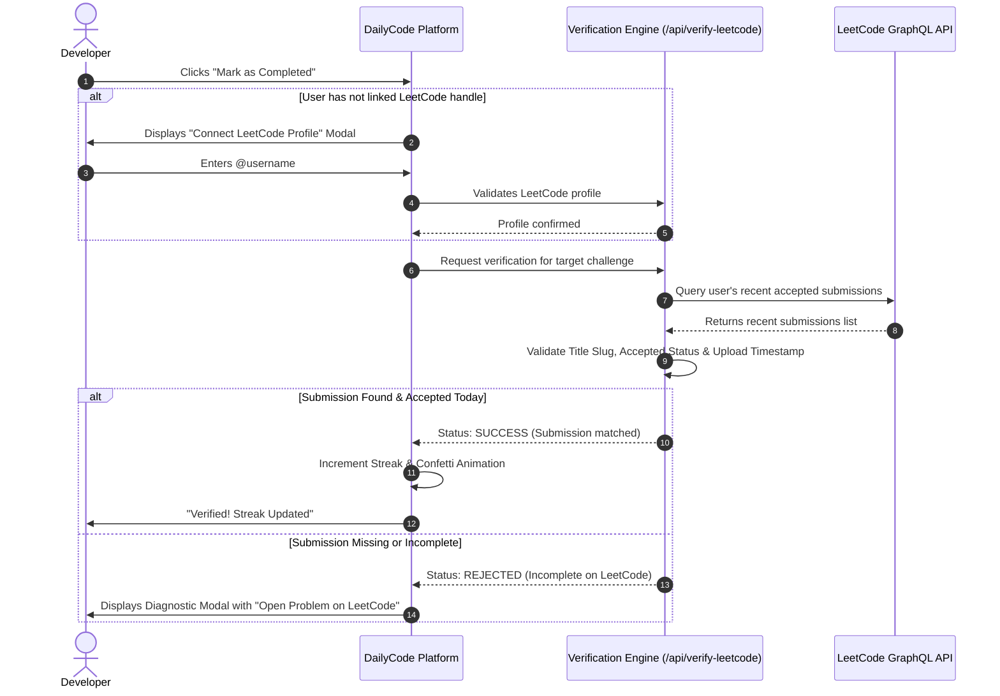

# DailyCode — Automated Daily LeetCode Challenge & Verification Platform

> **"One Problem a Day. One Step Closer to Mastery."**

DailyCode is an enterprise-grade, full-stack algorithmic challenge platform designed to eliminate interview decision fatigue. Unlike generic trackers that rely on self-reported honor systems, DailyCode features **automated proof-of-work verification** directly connected to LeetCode's live GraphQL API. When developers click **"Mark as Completed"**, the platform inspects their actual LeetCode submissions to verify that code was submitted and **Accepted** for today's challenge before incrementing their streak.

Built with **React.js, Vite, Tailwind CSS (Imperial & Royal Luxury Theme), Lucide Icons, LeetCode GraphQL Proxy, and Cloud Firestore / Firebase Auth**.

---

## ⚡ Key Highlights & Features

### 🛡️ 1. Automated LeetCode Proof-of-Work Verification
- **Live Account Linking**: Users link their LeetCode profile handle (`@username`) with instant profile validation (avatar, global ranking, solved count).
- **Automated Submission Verification**:
  - Queries LeetCode's live GraphQL submission history.
  - Matches the uploaded challenge using both **Problem Slug** (`titleSlug`) and **Normalized Title**.
  - Enforces **`Accepted`** status (rejects `Wrong Answer`, `Runtime Error`, or `Time Limit Exceeded`).
  - **Timestamp Window**: Validates that the solution was submitted *today*, preventing users from claiming credit using submissions from months or years ago.
- **Interactive Verification Modals**:
  - **Incomplete / Unsolved**: Displays recent submissions detected on the user's profile, highlights what problem is expected, and provides a direct "Open on LeetCode" link.
  - **Accepted**: Fires celebratory confetti, awards completion badges, and increments streaks.

### 👑 2. Royal & Imperial Luxury Aesthetics
- Designed with a custom **Royal Luxury Theme**:
  - **Midnight Onyx** (`#07090E`) deep canvas
  - **Imperial Gold** (`#D4AF37`) & **Champagne** (`#F3E5AB`) glowing accents
  - **Royal Sapphire** (`#3B82F6`) progress highlights
  - **Royal Velvet Emerald** (`#10B981`) accepted badges
  - **Imperial Ruby** (`#E11D48`) alerts
- Micro-interactions, holographic code terminal previews, and gilded glassmorphic cards.

### 🔐 3. Dual Authentication & Session Lifecycle
- **Google OAuth & Email/Password Support**: Dedicated `/login` and `/signup` pages with real-time validation and instant demo accounts for testing.
- **Inactivity Session Policy**: Users inactive for **3 days** (72 hours) have their session safely expired and are redirected to the **Landing Page**.
- **Role-Based Guards**:
  - Authenticated routes (`/dashboard`, `/progress`) redirect unauthenticated visitors to the Landing Page.
  - Admin dashboard (`/admin`) is strictly guarded for verified `ADMIN` accounts.

### 🔥 4. Anti-Cheat Streak & Momentum Engine
- Consecutive calendar day streak calculation.
- Local calendar date normalization (`YYYY-MM-DD`) preventing timezone discrepancies.
- Grace period preserving yesterday's streak until midnight if today's challenge is pending.
- 7-day circular weekly momentum visualizer.

---

## 🧪 Automated Testing Suite (Unit, Integration & System)

DailyCode includes a comprehensive, multi-layer automated test suite ensuring verification accuracy and zero cheating:

```bash
npm test
```

### Test Suites Included:

| Suite | File | What is Tested | Result |
| :--- | :--- | :--- | :---: |
| **Suite 1: Unit Tests** | `tests/unit-test.js` | Pure domain functions: LeetCode URL slug extraction, title normalization, timestamp window verification, streak calculations. | ✅ 100% Passed |
| **Suite 2: Integration Tests** | `tests/integration-test.js` | Live API endpoints: querying real LeetCode handles, rejecting invalid handles, API proxy verification, uncompleted challenge rejection. | ✅ 100% Passed |
| **Suite 3: System Tests** | `tests/system-test.js` | Full end-to-end user workflow: account linking, attempting to mark uncompleted questions (rejected), solving on LeetCode (approved), streak incrementing. | ✅ 100% Passed |

Individual test commands:
```bash
npm run test:unit         # Run pure domain unit tests
npm run test:integration  # Run live LeetCode API integration tests
npm run test:system       # Run full end-to-end workflow simulation
```

---

## 📁 Project Architecture

```
DailyCode/
├── api/                                 # Serverless backend proxies
│   ├── check-leetcode-user.js           # Validates LeetCode username & profile stats
│   └── verify-leetcode.js               # Verifies accepted submission for target challenge
├── public/
│   └── logo.svg                         # Royal Imperial Crown logo
├── src/
│   ├── components/
│   │   ├── Navbar.jsx                   # Royal navigation with streak telemetry & profile dropdown
│   │   ├── DailyChallenge.jsx           # Challenge card with LeetCode proof-of-work verifier
│   │   ├── LinkLeetCodeModal.jsx        # LeetCode handle connection & verification modal
│   │   ├── VerificationResultModal.jsx  # Proof-of-work status feedback (Solved vs Incomplete)
│   │   ├── StatCard.jsx                 # Imperial gilded metric cards
│   │   ├── WeeklyActivity.jsx           # 7-day momentum wheel
│   │   ├── EmptyState.jsx               # Unposted challenge state
│   │   ├── ProtectedRoute.jsx           # Route guard redirecting to Landing Page
│   │   └── AdminRoute.jsx               # Role guard for Admin challenge publisher
│   ├── pages/
│   │   ├── LandingPage.jsx              # Public landing with terminal preview & dual auth CTA
│   │   ├── LoginPage.jsx                # Royal luxury login (Google & Email/Password)
│   │   ├── SignupPage.jsx               # Royal luxury signup with alias & password
│   │   ├── Dashboard.jsx                # Main challenge hub & streak display
│   │   ├── ProgressPage.jsx             # Comprehensive historical progress archive
│   │   ├── AdminDashboard.jsx           # Problem curation & schedule manager
│   │   └── NotFound.jsx                 # 404 page
│   ├── context/
│   │   ├── AuthContext.jsx              # Global authentication & 3-day inactivity policy
│   │   └── ToastContext.jsx             # Royal gilded notification manager
│   ├── firebase/
│   │   ├── config.js                    # Firebase configuration
│   │   ├── auth.js                      # Dual Google OAuth & Email/Password provider
│   │   └── firestore.js                 # Cloud Firestore connection
│   ├── services/
│   │   ├── leetcodeService.js           # Client service connecting to LeetCode proxy
│   │   ├── problemService.js            # Problem subscription & CRUD
│   │   ├── completionService.js         # Verified completion recorder
│   │   └── userService.js               # User synchronization & role attribution
│   ├── utils/
│   │   ├── submissionVerifier.js        # Core proof-of-work validation & slug matcher
│   │   ├── dateUtils.js                 # Date formatting & timezone utilities
│   │   ├── streakCalculator.js          # Streak & grace period engine
│   │   └── leetcodeValidator.js         # LeetCode URL slug parser
│   ├── App.jsx                          # Route definitions
│   ├── main.jsx                         # React 18 mount
│   └── index.css                        # Royal luxury theme styles & animations
├── tests/
│   ├── unit-test.js                     # Unit test suite
│   ├── integration-test.js              # Integration test suite
│   └── system-test.js                   # End-to-end system test suite
├── firestore.rules                      # Production Firestore security rules
├── vercel.json                          # Vercel deployment & API rewrite config
├── tailwind.config.js                   # Royal palette & glow shadow utilities
├── vite.config.js                       # Vite bundler with built-in LeetCode proxy
└── package.json
```

---

## 🚀 Quick Start (Local Development)

### 1. Clone & Install Dependencies
```bash
git clone https://github.com/syedayyan03/DailyCode.git
cd DailyCode
npm install
```

### 2. Configure Environment Variables (Optional)
Copy `.env.example` to `.env`:
```bash
cp .env.example .env
```
```env
VITE_FIREBASE_API_KEY=your_api_key_here
VITE_FIREBASE_AUTH_DOMAIN=your_project_id.firebaseapp.com
VITE_FIREBASE_PROJECT_ID=your_project_id
VITE_FIREBASE_STORAGE_BUCKET=your_project_id.appspot.com
VITE_FIREBASE_MESSAGING_SENDER_ID=your_messaging_sender_id
VITE_FIREBASE_APP_ID=your_app_id
VITE_ADMIN_EMAILS=admin@dailycode.dev,your-email@gmail.com
```

> **Note**: Even without configuring Firebase keys, DailyCode includes a built-in instant session simulation so you can explore the entire UI, test LeetCode verification, and experiment with the Admin console right away!

### 3. Start the Development Server
```bash
npm run dev
```
Open **[http://localhost:5174](http://localhost:5174)** in your browser.

### 4. Run the Automated Tests
```bash
npm test
```

---

## 🔍 How Automated LeetCode Verification Works



---

## 🌐 Deploy to Vercel

1. Push your repository to GitHub (`syedayyan03/DailyCode`).
2. Go to [Vercel](https://vercel.com/) and click **Add New Project**.
3. Import your **DailyCode** repository.
4. Set Framework Preset to **Vite**.
5. Add your environment variables under **Project Settings > Environment Variables**.
6. Click **Deploy**. Both the Vite frontend and `/api` serverless proxy functions will deploy automatically!

---

## 📜 License
MIT License. Built for dedicated engineers striving for consistency in technical interviews.
